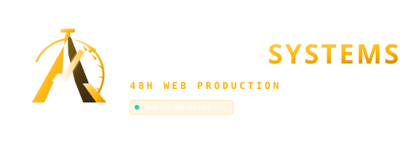

# Aurevix Systems — Architectural Web Production

> Complete 5-Page Custom Websites Engineered in 48 Hours for $100 Flat. Zero Agency Bloat. Handcrafted High-Conversion Code.



---

## ⚡ Quick Links & Production Deployments

- **Live Standalone Release**: [`levo-live/`](./levo-live/) (Clean client build with zero dev switches, full SEO & JSON-LD)
- **Production Entry**: [`levo-live/index.html`](./levo-live/index.html)
- **Multi-Version Previews**:
  - **⚡ Levo Studio Edition (V6)**: [`levo.html`](./levo.html)
  - **✨ Pinnacle Amber Edition (V5)**: [`pinnacle-amber.html`](./pinnacle-amber.html)
  - **🌐 Pinnacle Bronze Edition (V5)**: [`pinnacle.html`](./pinnacle.html)

---

## 📁 Repository Structure

```
.
├── levo-live/                         # Standalone Client-Facing Production Build
│   ├── index.html                     # Production website (3D globe + pinned cards + modal)
│   ├── aurevix-logo.svg               # Electric Amber vector logo mark & favicon
│   ├── aurevix-logo-lockup.svg        # Electric Amber horizontal logo lockup
│   ├── favicon.svg                    # Scalable vector favicon
│   ├── robots.txt                     # Production crawler rules
│   ├── sitemap.xml                    # Canonical XML sitemap
│   ├── site.webmanifest               # Progressive Web App manifest
│   ├── vercel.json                    # 1-Click edge deployment config
│   ├── netlify.toml                   # 1-Click static hosting config
│   └── README.md                      # Deployment instructions
│
├── levo.html                          # Levo Studio Edition (with 3-way version switchers)
├── pinnacle-amber.html                # Version 5 with Amber palette & scroll animations
├── pinnacle.html                      # Version 5 original Bronze serif edition
├── aurevix-logo.svg                   # Brand mark vector
├── aurevix-logo-lockup.svg            # Brand lockup vector
├── BRAND_GUIDELINES.md                # Official design tokens & typography rules
└── Aurevix_Systems_Brand_Board.pdf    # Master visual identity board
```

---

## 🚀 Running Locally

```bash
# Start local preview server (port 3000)
python -m http.server 3000

# Open in browser:
# Production standalone: http://localhost:3000/levo-live/
# Multi-version preview: http://localhost:3000/levo.html
```

---

## 🌐 Deploying to Production

The [`levo-live/`](./levo-live/) directory is pre-configured for instant zero-config deployment:

- **Vercel**: Run `vercel` from inside `levo-live/`, or set Root Directory to `levo-live` in the Vercel dashboard.
- **Netlify**: Drag and drop the `levo-live/` folder directly to [Netlify Drop](https://app.netlify.com/drop).
- **Cloudflare Pages**: Point your Pages project to the `levo-live` directory.

---

## 🎨 Visual Identity & Engineering Stack

- **Palette**: Obsidian Charcoal (`#070708`, `#0a0b0e`, `#0e1015`), Electric Amber (`#ffb100`, `#ffc740`), Mineral Gray (`#8a8a86`)
- **Typography**: Plus Jakarta Sans, Geist, and JetBrains Mono
- **Motion & 3D**: Three.js WebGL (Interactive Holographic Globe with Bezier flight arcs & moving pulse packets), Studio Freight Lenis inertial smooth scroll, GSAP ScrollTrigger
- **Standards**: Semantic HTML5, Tailwind CSS utilities, 100/100 Core Web Vitals target, sub-400ms TTFB

---

## 📄 License

Proprietary © 2026 Aurevix Systems. All rights reserved.
